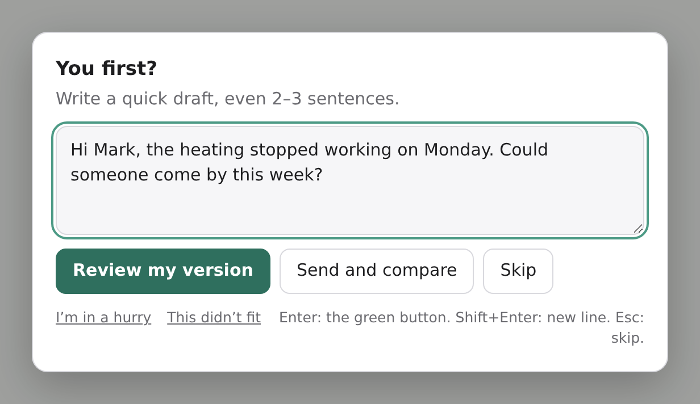

# First You — Screen Time for your thinking

**Try first, then ask AI.** A small browser extension for ChatGPT, Claude and Gemini that, for the kinds of tasks *you* choose, suggests a quick try of your own before the prompt goes out. It doesn't block anything, it stays quiet most of the time, and it runs entirely in your browser.



## Why

Handing AI the small stuff is convenient, and that's exactly how skills quietly fade: writing a message, estimating a number, remembering a fact, forming your own opinion, guessing why the code broke. First You adds a moment of friction only where you asked for it, and turns AI from the author into the reviewer.

## What it does

- **You pick what to practise:** writing messages, mental math, recalling facts, understanding a text, your own opinion, debugging, or any phrase of your own ("translate", "LinkedIn post").
- **When a prompt matches, a small window asks for your own try first:** a quick draft, an estimate, a one-sentence guess, your hypothesis about the bug.
- **Then you choose:**
  - **Review my version:** your prompt goes out with your try, asking the AI for feedback instead of a rewrite.
  - **Send and compare:** the original prompt goes out unchanged; your try stays next to the answer.
  - **Skip**, **I'm in a hurry** (2 hours off), or **This didn't fit**.
- **Weekly report:** your own tries, how often your estimates and guesses land, how much your drafts needed fixing, and a neutral mirror of what you use AI for. Plus a share card.

Everything else goes straight through, with no delay. At most 3 windows a day by default; a category goes quiet for a week after 3 skips in a row.

## How it decides

Local rules in English and Polish, tuned for **precision, not recall**: the window shows up only on strong, unambiguous signals, mostly at the start of a prompt ("write an email to…", "what is 15% of 80", "should I…", a pasted stack trace). Mid-conversation follow-ups like "shorten it" never trigger it. No AI model is involved in the decision. See [`src/classifier`](src/classifier) and the test set in [`tests/fixtures`](tests/fixtures).

## Privacy

- **Nothing leaves your browser.** No account, no server, no analytics, no network requests from the extension.
- The text of a prompt is read **on your device only**, at the moment you send it, to decide whether to show the window. It's never stored.
- Your tries and per-prompt statistics (without prompt text) stay in browser storage and expire after 30 and 90 days. Export or delete everything in Settings.
- Permissions: `storage` (settings and local stats), `alarms` (weekly summary, cleanup), and access to chatgpt.com, claude.ai and gemini.google.com only.

Full policy: [PRIVACY.md](PRIVACY.md) · [Polski](PRIVACY.pl.md)

## Install

- **Chrome Web Store:** link coming after review.
- **From source:** `npm install && npm run build`, then load `.output/chrome-mv3` via `chrome://extensions` → Developer mode → Load unpacked. Works in Chrome, Edge and Brave.

Firefox and Safari aren't supported yet.

## When a chat site changes

Chat apps change their HTML often. Site knowledge lives only in [`src/adapters`](src/adapters); if a site breaks, the extension goes silent rather than getting in your way. To update an adapter from a fresh DOM capture, see [docs/ADAPTERS.md](docs/ADAPTERS.md). Please [open an issue](../../issues/new/choose) with the site and what happened.

## Contributing

Issues for windows that showed up where they shouldn't, or missed obvious cases, are the most useful contribution: they become test cases. Development setup and architecture: [docs/DEVELOPMENT.md](docs/DEVELOPMENT.md).

```bash
npm install
npm run dev        # Chrome with the extension and a fake-chat playground
npm test           # unit tests
npm run test:e2e   # Playwright: playground + minimized copies of ChatGPT, Claude and Gemini
```

## License

[MIT](LICENSE)
